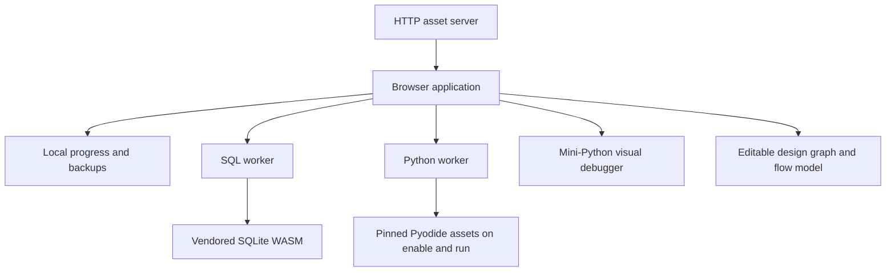
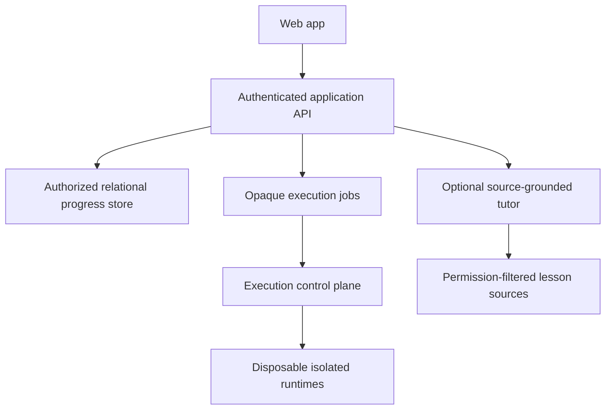

# Architecture: the v0.3 practice app and its boundaries

TraceCraft remains an **alpha** with on-device drafts and required verified email sign-in. `src/auth-gate.mjs` gates every workspace until the session endpoint confirms a verified email-code account. It provides five-minute code expiry and resend feedback; server checks remain authoritative. Vercel serves the static browser app plus a same-origin Node account function. Better Auth verifies email codes; Resend delivers transactional sign-in messages; Neon Postgres stores verified users, sessions and reviewed progress. The separate Node/GitHub/SQLite adapter is retained for local operators. All learner SQL/Python execution remains in browser workers. See [PROGRESS_SYNC.md](PROGRESS_SYNC.md) for the account contract.

## API adventure

`#apis` adds nine tracks with overview, track, lesson, daily-review, model-lab and track-checkpoint routes. `api-*-content.mjs` contains original course/question/source material; `api-course-state.mjs` validates optional versioned `training.apis` progress. `api-course.mjs` renders the six-step lesson and guided request controls. `api-rest-model.mjs` and `api-models.mjs` evaluate allowlisted synthetic inputs with generated messages and steps; they make no network requests. `api-live-http.mjs` permits only the explicit bounded same-origin health GET. Model evidence is separate from recognition, real worker execution and self-assessment. `arcade-icons.mjs` extracts the existing pure icon renderer to avoid an app-controller import cycle. Shared HUD statistics include first-correct API questions. Existing snapshot/backup/account boundaries include the new optional state without storing a new credential. See [API_ADVENTURE.md](API_ADVENTURE.md).

## Connected practical learning

`#tcs` is a named 25-lesson path with main/mobile navigation, Start here/library entry points and search indexing. `tcs-content.mjs` contains original teaching and authored recognition questions, `tcs-lab-content.mjs` supplies eight CPython/two SQLite tasks, `tcs-state.mjs` validates optional training state and `tcs.mjs` renders the overview/lesson/mixed-review routes. Notes and predictions are escaped and bounded. Recognition correctness is derived from canonical options and invalidated when edited or obsolete. Read marks and latest runnable checks remain separate. Existing training and account snapshots include the TCS state without a new credential or persistence system. See [TCS_PATH.md](TCS_PATH.md).

`#coach` adds one private learning loop without replacing existing workspaces. `learning-coach-content.mjs` combines 91 executable tasks with 35 authored scenarios and 62 skill definitions. The practical packs add 12 Python fluency tasks and 15 fitness SQLite tasks; their solutions and deliberate bugs run through the retained workers. `practical-lab.mjs` adds prediction gating and explicit help levels. Learn mode records its conceptual nudge as assistance; documentation use is also retained separately.

`learning-coach-state.mjs` validates the optional version-1 coach object within training progress: blank private profile fields, six diagnostic steps, scenario responses/checks, notebook drafts/entries, reasons and configurable review rules. It never derives correctness from free text or confidence. Notebook entries link actual attempts and bounded execution results where available. `coach-recommendations.mjs` prioritizes capped due reviews, unfinished diagnostics, relevant observed checks and selected goals without diagnosing a whole language from one failure. Snapshots pause clocks and include coach state in the existing reviewed account/backup contract. Old snapshots default safely.

`learning-coach.mjs` renders daily, diagnostic, skills, notebook, question, walking and profile routes. Scenario checking resolves canonical versioned options; writing and rubric boxes remain self-assessment. Optional clocks pause on navigation, hiding and reload. Browser speech synthesis is explicit and cancellable; no microphone, transcription or remote AI provider is used. See [scope and continuation](PLATFORM_IMPLEMENTATION.md).

## Beginner learning and navigation

`#learn` is the default signed-in entry. `#beginner` groups 25 lessons into Python, SQL, and Java tracks, and `#practice` explains the available practice tools. Existing URLs, full Python/SQL, system design, project milestones, and the interview course remain available.

`src/beginner*.mjs` contains original teaching, 9 new runnable Python tasks, 5 new runnable SQLite tasks and bridges to existing tasks. `src/beginner-java*.mjs` and `src/java-bridge-content.mjs` supply Java teaching and 21 optional recognition questions. `src/java-content.mjs` and `src/java-algorithms-content.mjs` supply ten editable checked tasks. `src/java-workbench.mjs` saves drafts, input values, explanations and practice evidence. Separate compiler and execution workers use vendored javac/TeaVM WebAssembly with strict import policy, bounded output and phase deadlines. Corresponding sources and licenses are served beside the assets. See [JAVA_RUNTIME.md](JAVA_RUNTIME.md).

`src/beginner-state.mjs` validates known lesson IDs, a remembered lesson, self-reported read marks, and notes bounded at 3,000 characters each. These records live in the existing training workspace and are included in reviewed complete account snapshots and backups. Suggestions inspect the latest actual code check or completed recognition questions separately from read marks. Failed browser writes show a persistent failure message; credentials are not added to progress.

## Beginner arcade and autosave

`src/arcade-content.mjs` combines six foundation quests, six Python-pattern quests from `src/interview-arcade-content.mjs`, and six JavaScript/React models from `src/frontend-course-content.mjs`. Its 54 questions have fixed authored answers. `src/arcade.mjs` renders the collection filter, quest path and one-question flow; it never executes submitted code. `src/arcade-state.mjs` validates bounded answers, first completions, and hint use. XP is derived from distinct completions, never incremented per click. This recognition practice is distinct from executable lab passes. Its state lives inside the existing training workspace, so training backups and owner-scoped complete snapshots include it. Node tests execute only the authored JavaScript reference and deliberate-bug functions; no learner JavaScript interpreter was added.

## Interview course and rehearsal evidence

`#developer-path/course` extends the retained project milestones with 21 ordered lessons, each containing an outcome, prerequisite links, three teaching sections/examples/pitfalls, a reflection prompt, self-checks and a follow-up. `src/interview-course-content.mjs` owns the original material and three rehearsal presets. All 22 Python and 18 SQL exercises are linked. Frontend lessons point to recognition models and external project assignments; they do not imply a React runtime or automated project assessment.

`src/interview-course.mjs` renders overview, lesson, mock and evidence views. `src/interview-course-state.mjs` validates bounded notes, known IDs, saved self-checks, one active rehearsal and the latest 30 debriefs. Starting a mock archives its linked drafts through the existing fresh-attempt mechanism. It preserves help already recorded that day. Evidence uses the latest check for an exercise, so a newer failure overrides a previous pass. Mock evidence counts only checks since the rehearsal started and freezes content/runtime revisions at debrief time. Read marks and notes never become code passes.

The optional clock continues across lab navigation in the visible tab, pauses when hidden or gated, and never completes work. `trainingSnapshot` deducts elapsed time into a paused copy for storage, export and account snapshots without mutating the active clock. Restored clocks stay paused. Course state is part of the existing validated training workspace and revision-checked account snapshot; no new account store or credential handling is introduced.

`src/account-sync.mjs` manages optional autosave after the learner chooses a reviewed starting copy. It checks current sessions, retains revision conflicts, pauses on errors, and sends an expected user ID that the API checks against its validated session. Only owner/revision preferences enter browser storage. It does not store tokens, silently merge snapshots, or restore remote data without review. Existing seven-day Better Auth sessions remain HttpOnly.

## Hosted account boundary

`api/index.mjs` exports a Web Request/Response handler. `server/hosted-api.mjs` allows only email-code send, verify and sign-out auth routes. It strips opaque session tokens from JSON, preserves HttpOnly cookies and requires the exact configured Origin plus a custom header for mutations. Accounts must have verified email before progress access. User ownership comes from the validated session, never a request owner field.

`server/runtime.mjs` reuses a small Postgres pool registered with Vercel's pool lifecycle. `server/postgres-store.mjs` validates snapshots, enforces 4 MB and compares revisions in the same SQL write. `server/email.mjs` applies atomic daily/address quotas and bounded retries with a stable idempotency key. Codes are hashed in the auth database, expire in five minutes and allow three wrong guesses. The database is not a program runner.

Schema changes run explicitly through `npm run db:migrate`, never inside a user request. Hosted configuration fails closed when incomplete. The static build excludes server files and credentials. Vercel bundles the function separately; `vercel.json` supplies routing and browser security headers. The ignored environment files are excluded from deployment uploads as well as Git.

## Implemented system

The Node server serves files; it never executes learner Python, SQL or Java. SQLite runs inside a browser worker using vendored assets. The full-Python worker loads a pinned Pyodide distribution after explicit UI enablement and a run/check action. The original Mini-Python interpreter stays available as a separate, clearly labeled teaching model.

| Source | Responsibility |
|---|---|
| `src/app.mjs` | Shared navigation/shell and original visual lab, topic map, demos, studio, reading, and settings |
| `src/design.css` / `src/system-design.css` | Redesigned shared workspace and system-design canvas/inspector/table layouts |
| `src/training.mjs` | Daily workspace, SQL/Python editors and worker lifecycle, architecture prompts, evidence UI, backup controls |
| `src/training-state.mjs` | State validation, day keys, help records, checked attempts, and review scheduling |
| `src/training-content.mjs`, `src/interview-python-content.mjs`, `src/curriculum.mjs` | 56 assignments, 22 Python drills, six architecture scenarios and eight milestone guides with saved self-assessment |
| `src/sql-content.mjs`, `src/interview-sql-content.mjs` | 18 SQL exercises, seeds, changed fixtures, contracts, reference solutions, and deliberate bugs |
| `src/interview-course*.mjs`, `src/interview-course.css` | Original interview lessons, route rendering, evidence derivation, rehearsal clocks, validation and responsive reading layout |
| `src/sql-runtime.mjs` / `src/sql-worker.js` | SQL controller deadlines, worker protocol, disposable databases, execution and fixture checks |
| `src/python-runtime.mjs` / `src/python-worker.js` | Python controller, Pyodide initialization, CPython harness, assertions, traces and cancellation |
| `src/java-runtime.mjs`, `java-compile-worker.mjs`, `java-run-worker.mjs`, `java-program-policy.mjs` | Browser javac/TeaVM compilation, isolated program execution, typed import restrictions, watchdogs and cancellation |
| `src/system-design.mjs` | Graph editing, inspector, canvas/table views, simulation controls, checks, assistance, notes, and import review |
| `src/system-design-state.mjs` | Validated design drafts, settings, help records, recent check history, and backup serialization |
| `src/system-design-engine.mjs` | Pure bounded graph validation, deterministic flow calculation, and public requirement evaluation |
| `src/system-design-content.mjs` | Six original challenge contracts, baseline and changed workloads, reference graphs, and deliberate bugs |
| `public/vendor/sqljs/` | Pinned sql.js/SQLite distribution and license |
| `scripts/progress-api.mjs` / `scripts/progress-store.mjs` | Optional GitHub OAuth, app sessions, authorized SQLite snapshots, revision conflicts, and account deletion |
| `src/progress*.mjs` | Validated complete backups, manual sync review, restore recovery, and browser account UI |
| `src/backend-content.mjs` / `src/practice-versions.mjs` | Four original backend exercises and version labels retained on checked attempts |
| `scripts/serve.mjs` / `scripts/build.mjs` | Local static serving and directory build; neither runs learner submissions |

## Execution boundaries

### SQL

The runtime pins sql.js 1.15.2 and displays `sqlite_version()` from the actual engine. Each lab starts from an empty database or its seed, with foreign keys enabled before seeding. **Run** changes the current practice database. **Check** executes the submission in separate fresh databases for each public fixture. Query checks compare results; mutation exercises inspect actual schema/data state. Duplicate result rows remain meaningful, and ordering is checked only where the contract requires it.

Leaving the lab, resetting, cancelling, or terminating its worker discards the in-memory database. Saved SQL editor text and attempt records are a separate progress concern. Checks do not mutate the Run workspace. Multi-statement scripts are not automatically made atomic; explicit transactions and partial failure are part of the learning behavior.

A main-thread watchdog terminates long-running work. Source length, statement/result counts, materialized output, SQLite heap, and initial database-page limits bound ordinary practice. These controls do not certify the runtime as safe for adversarial public grading. Full constants, provenance, and test coverage are in [SQL_LAB.md](SQL_LAB.md).

This is **SQLite**, not a MySQL/PostgreSQL server. The local database-management assignments intentionally use a separate real database process for accounts, concurrent sessions, engine-specific isolation, migrations, backup/restore, and operations.

### Full Python

The new lab pins Pyodide 314.0.7, a CPython WebAssembly distribution. Constructing the controller does not fetch it. After enablement, a run or check initializes a module worker and downloads runtime assets from the pinned jsDelivr base. TraceCraft has no remote code execution endpoint and does not upload the learner’s source as part of that loading flow. The CDN receives normal asset-request metadata.

Each run creates a fresh learner namespace; the interpreter and imported module cache can be reused until the worker is disposed. A fresh namespace is not a fully reset machine. The harness compiles learner source with a fixed filename, executes it in CPython, and optionally executes public assertion source. Python functions, classes, dictionaries, strings, slices, and integers come from that runtime, not a JavaScript approximation.

The harness records actual `sys.settrace` events for learner code. A `line` event describes state **before** that line runs; return and exception events describe those actual events. Trace frames distinguish initial program execution from learner functions invoked by the checks. Values are bounded text snapshots, not a full object-identity graph. The UI escapes source, output, errors, and local values.

Startup and execution deadlines terminate the worker; output and trace sizes are bounded. There is no independent hard memory quota and no guarantee that all desktop Python packages or operating-system features work. An empty JavaScript globals bridge reduces accidental exposure but does not establish network isolation. Browser runtime loading/CSP checks are separate from local CPython harness tests. See [PYTHON_RUNTIME.md](PYTHON_RUNTIME.md).

### Original Mini-Python

The Visual debugger still uses the original bounded interpreter: numeric/boolean expressions, flat lists, assignments, selected compound assignments, `for`, `if/else`, `print`, and selected built-ins. It has no functions, classes, strings, imports, or general JavaScript execution. Its JavaScript numeric representation and materialized `range` differ from CPython.

Limits remain 12,000 source characters, 160 lines, 500 trace frames, 50,000 counted operations, 200 list/range items, and finite numeric magnitude at most 1e12. Its snapshots show state **after** an operation. That differs deliberately from the new Python lab’s `line` event convention; the interfaces label their timing.

The old systems row-filtering model is a JavaScript demo, and the retrieval model is keyword matching without generation. Neither becomes a SQL engine or a complete RAG system merely because a new runtime exists elsewhere in the application.

### System design

The system-design engine is a pure local calculation over a bounded graph. It starts no server processes and sends no simulated requests over the network. One traffic source supplies a fixed average read/write rate. Directed connections determine where that traffic travels; only load balancers split a stream, avoiding accidental request duplication.

Cache/CDN hits complete only the read portion of traffic. Databases are terminal completion points. Processing overload and broken routes produce failed work; rate limiting is counted separately as deliberate rejection. A supported asynchronous branch may contain one finite queue, whose unfinished writes remain pending up to the buffer limit. The graph must be acyclic, and queued work cannot merge with a synchronous branch.

Each valid simulation conserves offered work across completed, rejected, failed, and pending rates. Estimated mean completion latency is a completed-flow-weighted sum of configured service times. It excludes queue waiting, congestion, jitter, network distance, and tail percentiles. Capacity, hit rate, and service time are editable assumptions, not observed infrastructure performance. See [SIMULATION_MODEL.md](SIMULATION_MODEL.md) for exact fields, bounds, and queue arithmetic.

Challenge checks evaluate the submitted graph against an authored baseline and changed fixtures, independently of exploratory settings. Requirements inspect flow, named paths, and configuration budgets. Reference solutions and deliberate failures are regression-tested. These checks do not grade business boundaries, consistency, authorization, or architectural suitability; explanations remain self-assessed.

The UI displays the same calculated results on its diagram and tables. Pointer dragging and keyboard movement update node positions. Inspector and table controls provide connection operations without drawing. Functional changes invalidate prior check results; layout-only changes do not alter simulation meaning. Undo/redo history is bounded and session-local.

## Progress and assessment model

Training progress uses `tracecraft:training:v1`; the original visual/studio state remains under `tracecraft:v1`. System-design work has its own `tracecraft:system-design:v1` record. These stores preserve their separate schemas. The optional account API synchronizes a validated snapshot containing all three workspaces, with explicit whole-snapshot conflict review. Browser copies remain local and unencrypted.

Training records include the selected assignment, self-reported block/day completion, drafts, explanations, help views, checked attempts with source text and time, review state, reflection notes, and remaining session time. Validation bounds imported fields and collections. Export produces a JSON training backup; validated import replaces that training workspace while preserving the original visual/studio store. SQL database bytes and the Python interpreter state are not part of the backup.

The two-hour countdown is a planning aid: 110 work minutes plus a 10-minute break. It pauses when the page is hidden or closed and never marks a lesson complete merely because time elapsed. Work in an IDE or database client should be documented as evidence; the browser timer is not an external activity monitor.

In-app hint/solution views and deliberate-bug loads mark assistance for that exercise/day. A passing check with no recorded in-app help is labeled independent, but the app cannot detect outside notes, another AI tool, or prior exposure to a solution. This is honest personal practice data, not proctored assessment.

A checked attempt schedules review. Independent passes on later days extend the suggested interval through 1, 3, 7, and 14 days; repeated same-day passes do not advance it. Failed or assisted checks return the task to a one-day retry. This deterministic schedule is not evidence of measured learning effectiveness.

Architecture explanations and project gates are self-assessed. Public fixtures and assertion source are inspectable and can be bypassed by a determined user. Do not use client-side completion for certification, contest ranking, entitlement enforcement, or hiring predictions.

System-design state includes per-challenge diagrams, exploratory settings, notes, in-app help level, and the latest 100 checks with diagram snapshots. JSON exports use `tracecraft-system-design`, version 1. Imports validate the supported structure, enforce a 2 MB cap, and display a replacement review before overwriting the design workspace. They do not replace training or original-tool state. Undo/redo history is not a durable backup.

## Serving, builds, and access

The build copies the source and assets into `dist/` without installing npm dependencies. `dist/tracecraft-preview.html` remains a second HTML entry referencing that directory; it is no longer an inlined, standalone app. Worker/module/WASM loading requires HTTP(S), correct MIME types, and an appropriate Content Security Policy. The default local server accepts `--host`, `--port`, and `--dist`.

The generated `_headers` file expresses intended static-host security headers, but whether a host applies it must be verified on the deployed site. WebAssembly requires the appropriate WASM CSP permission; it does not require general JavaScript `unsafe-eval`. Hosting policy and worker responses are part of browser QA.

A local display name is not authentication. The earlier private Site's hosting gate is separate from the new public Vercel edition and its account ownership. No provider account is required for local practice. Hosted email sync requires the configured Postgres and sending service; the legacy local GitHub adapter instead requires an OAuth app and persistent SQLite volume. Neither the build nor tests provision paid services.

## Future execution and tutor architecture: not implemented

The implemented account service is a small same-origin Node API. The broader execution and tutor service architecture below remains future work. Separate the security boundary for server-side untrusted execution from the beginning rather than running submissions inside an API process.

The candidate data model includes users, lessons/revisions, exercises/test cases, attempts, assistance events, explanations, review records, project evidence, and source permissions. Keep runtime and content versions with attempts so results can be interpreted after updates. Authentication identifies the visitor; every data operation still needs authorization, retention, export, and deletion behavior.

If server execution is introduced, require disposable environments, denied networking by default, no application secrets or host sockets, explicit resource/output bounds, cancellation, quota enforcement, validated artifacts, and adversarial cross-user tests. A normal application container or a browser worker is not sufficient evidence for hostile multi-tenant isolation. This is a future engineering gate, not a property claimed by v0.3.

A future tutor must retrieve only authorized, licensed content, preserve source/version identifiers, test answer grounding separately from retrieval, and handle unsupported questions. An AI-generated explanation or score must be labeled by assessor type and grounded in observed attempts. Provider billing requires separate explicit configuration and budgets; there is no such integration in this release.

## Primary references

- [SQLite SQL and transactions](https://sqlite.org/lang.html)
- [sql.js documentation](https://sql.js.org/documentation/database/)
- [Pyodide worker architecture](https://pyodide.org/en/314.0.7/usage/webworker.html)
- [Python trace-event semantics](https://docs.python.org/3.14/library/sys.html#sys.settrace)
- [MySQL reference manual](https://dev.mysql.com/doc/refman/8.4/en/)
- [Microservices architecture trade-offs](https://learn.microsoft.com/en-us/azure/architecture/guide/architecture-styles/microservices)

For observed verification and remaining limits, use [QA.md](QA.md), not the presence of an architectural requirement in this document.
